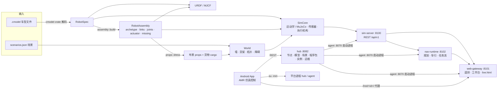
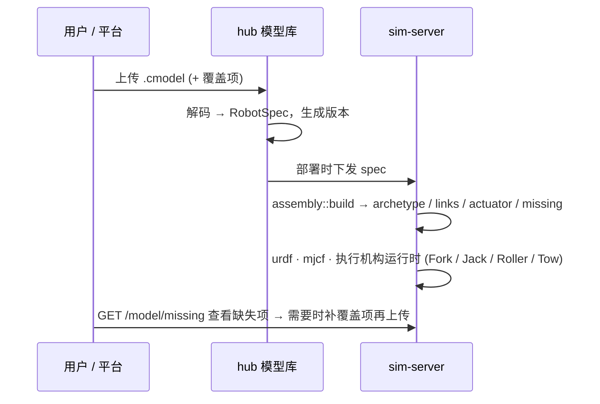
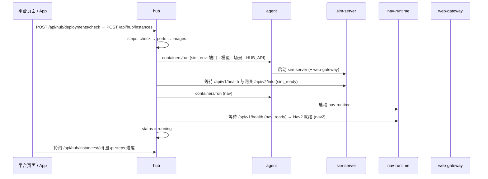
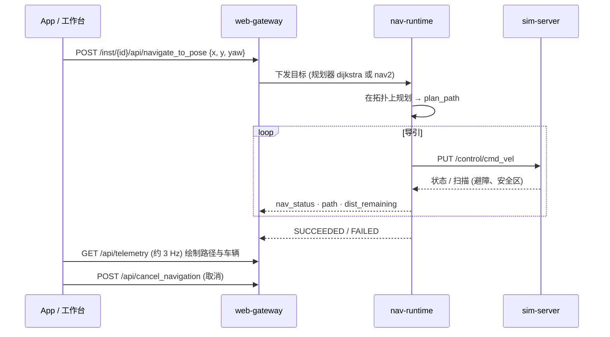

# 数据定义与工作流程 (Data & Workflow Definitions)

本文档描述 AMR 仿真平台 (`rust-rewrite` 分支) 中**流转的数据**和**各条业务流程**。字段以代码为准，文中注明出处文件，便于核对。

- 接口细节: [API_REFERENCE.md](API_REFERENCE.md)、[openapi/](openapi/)
- 车体装配: [ASSEMBLY.md](ASSEMBLY.md)
- 车型与场景适配: [MODEL_FIT.md](MODEL_FIT.md)
- 部署: [DEPLOY_ANDROID.md](DEPLOY_ANDROID.md)

---

## 0. 总览



| 进程 | 端口 (单手机默认) | 职责 | 源码 |
|---|---|---|---|
| hub | 8082 | 资源平台: 节点、模型、场景、程序包、实例部署、记录、运维更新；`/inst/<id>/` 反向代理 | `rust/crates/hub` |
| agent | 8070 | 节点代理: 按 hub 指令启动/停止进程 ("容器") | `rust/crates/agent` |
| sim-server | 实例 `sim_api` (8100) | 仿真引擎 REST | `rust/crates/sim-server` + `sim-core` |
| nav-runtime | 实例 `nav_api` (8102) | 路径规划、导引、任务流、Nav2 桥 | `rust/crates/nav-runtime` |
| web-gateway | 实例 `web` (8101) | 工作台前端、遥测聚合、控制权锁、记录、`live.html` | `rust/crates/web-gateway` |

所有进程都监听 `0.0.0.0`。单手机模式下实例端口也对局域网开放，`HUB_LOCAL_INSTANCES=1` 可恢复为只监听本机。

---

## 1. 数据定义

### 1.1 车型文件 `.cmodel` → RobotSpec

`.cmodel` 是 protobuf 编码的车型描述。`cmodel::decode_cmodel_bytes` 把它解码成 `CompDesc`，`cmodel::spec::extract_robot_spec` 再把 `CompDesc` 转成 **RobotSpec** (JSON)，所有尺寸单位为 m 和 rad。

| 字段 | 类型 | 说明 |
|---|---|---|
| `robot_name` / `model_file` | string | 车型名 / 文件名 |
| `chassis.type` | string | `diff_drive` · `single_steer` · `dual_steer` · `quad_steer` · `mecanum` … |
| `chassis.length_m` `width_m` `height_m` | number | 外形包络。`height_m` 可能包含门架或护栏 |
| `chassis.head_offset_m` `tail_offset_m` `left_offset_m` `right_offset_m` | number | 运动中心 (`x=0`，通常是驱动/载荷轴) 到四边的距离 |
| `chassis.footprint` | `[[x,y],…]` | 车体轮廓 (车体坐标，x 向前、y 向左) |
| `chassis.rotate_diameter_m` | number | 原地旋转直径 |
| `chassis.max_speed_mps` … `motion_idle` / `motion_full_load` | object | 空载 / 满载速度与加速度限制 |
| `wheels[]` | `{name, kind: steer\|drive\|fixed\|caster, x, y, z, radius_m, width_m, steer_min_rad, steer_max_rad, drive_motor}` | 轮系 |
| `lidars[]` | `{name, x, y, z, roll, pitch, yaw, vendor_model, fov_deg, min_range, max_range, resolution_deg, freq_hz, …}` | 激光。`roll≈π` 表示倒装 |
| `cameras[]` · `imu` | object | 相机 / IMU 安装与内参 |
| `io.inputs[]` · `io.outputs[]` · `io.buttons[]` | `{name, type, …}` | IO 与急停按钮 |
| `other_actuators[]` | `{name, model, rated_rpm, gear_ratio, …}` | 上装电机 (顶升 / 门架 / 辊筒 / 牵引) |
| `fork` | object 或 null | cmodel 的 `lifter` 模块: `x` (叉根)、`mast_max_m`、`tine_*`、`dir` |
| `assumptions[]` · `warnings[]` | string | 推断项与警告 |

**覆盖项 (overrides)**: `model/src/overrides.rs`。模型的 `actuator` 段可以人工指定上装参数，例如 `{"type": "stacker_fork", "fork_dir": -1, "stroke_m": 0.06}`。覆盖值优先于 cmodel，cmodel 优先于默认值。

### 1.2 RobotAssembly (`sim-core/src/assembly.rs`)

`assembly::build(spec)` 的输出。它是 URDF、MJCF、3D 视图和执行机构运行时的**唯一来源**。

| 字段 | 说明 |
|---|---|
| `archetype` | `jacking` · `reach_fork` · `stacker_fork` · `pallet_truck` · `roller` · `tugger` · `none` |
| `archetype_label` · `archetype_source` | 中文名 / 判定依据 (`override:…` 或 `inferred:…`) |
| `chassis` | `{type, length_m, width_m, height_m, body_top_m, clearance_m, center, mass_kg}` |
| `links[]` | `{name, parent, joint: {name, type: fixed\|prismatic\|revolute\|continuous, axis, xyz, rpy, lower, upper, mimic}, visuals[]}` |
| `visuals[]` | `{shape: box\|cylinder\|sphere, size\|radius+length, xyz, rpy, color, opacity, role}` |
| `actuator` | 上装参数，见下表 |
| `actuator.joints[]` | `{name, quantity, multiplier?}`: 执行机构关节和它对应的物理量 |
| `missing[]` | `{category, item, status: defaulted\|inferred\|missing, value, note}`: cmodel 缺失项清单 |

**类型判定** (`classify`，按顺序匹配，命中即停):

1. 人工覆盖 `actuator.type`;
2. 模块名或电机名含 roller / conveyor / 辊 → `roller`;
3. 含 tow / hitch / 牵引 → `tugger`;
4. 含 doorframe / reach / oil_pump / 门架 → `reach_fork`;
5. 有 `fork` 模块: 起升 ≤ 0.35 m → `pallet_truck`，否则 → `stacker_fork`;
6. 含 lift / jack / 顶升 且车高 > 0.8 m → `stacker_fork` (门架堆高车);
7. 含 lift / jack / 顶升，其余情况 → `jacking`;
8. 都不是 → `none`。

**`actuator` 参数** (按类型):

| 类型 | 主要参数 |
|---|---|
| jacking | `stroke_m` `lift_speed_mps` `tray_diameter_m` `rotate_speed_dps` `rack_clearance_m` `deck_z_m` (= 车体顶面) `limit_inputs` |
| reach_fork / stacker_fork / pallet_truck | `mast_max_m` `lift_speed_mps` `tine_length_m` `tine_width_m` `tine_thickness_m` `tine_spacing_m` `tine_root_x_m` `fork_dir` (+1 前向 / −1 后向) `max_load_kg`；reach_fork 另有 `reach_stroke_m` `reach_speed_mps` |
| roller | `roller_diameter_m` `roller_pitch_m` `transfer_speed_mps` `deck_z_m` `deck_length_m` `deck_width_m` `transfer_axis` |
| tugger | `hitch_x_m` `hitch_z_m` `pin_stroke_m` `max_articulation_deg` … |

**关节命名** (URDF、MJCF、joint_states 三处一致):

| 部件 | 关节名 |
|---|---|
| 舵轮 | `{w}_steer_joint`、`{w}_drive_joint` |
| 固定轮 / 驱动轮 | `{w}_joint` |
| 万向轮 | `{c}_swivel_joint`、`{c}_wheel_joint` |
| 顶升 | `lift_joint`、`tray_rotate_joint` |
| 叉车 | `fork_lift_joint`、`mast_stage_joint` (mimic ×0.5)、`reach_joint` |
| 辊筒 | `roller_{i}_joint`、`stopper_l_joint` / `stopper_r_joint` |
| 牵引 | `hitch_pin_joint` |

### 1.3 场景 Scenario (`rust/data/scenarios.json`)

```jsonc
{
  "rect_loop": {
    "id": "rect_loop", "name": "长方形环线制造车间", "description": "...",
    "origin":  {"x": -3.4, "y": -4.5, "yaw": 0.0},          // 出生位姿
    "walls":   [[x0, y0, x1, y1], ...],                      // 外墙线段 (高 6 m)
    "shelves": [[x0, y0, x1, y1] | {"name", "x1","y1","x2","y2","color","border"}, ...],  // 货架线段或工位矩形
    "nodes":   {"N_L_NW": [-6.8, 4.5], ...},                 // 拓扑节点
    "connections": [["N_L_NW", "N_L_N_W"], ...],             // 双向路线
    "stations": [{"id", "name", "x", "y", "dock_yaw", "color"}, ...]  // 站点 (停靠位姿)
  }
}
```

内置场景有 `grid_9_square`、`standard_cross`、`narrow_aisle`、`rect_loop`、`fms_workshop`、`fms_workshop_xl`。平台上的场景存在 hub 的场景库里 (版本化)，部署实例时下发给仿真进程。

### 1.4 World: 障碍、布景与货物 (`sim-core/src/world.rs`、`props.rs`)

`world.obstacles[]` 中每个对象的公共字段: `{id, type, x, y, yaw, w, h, z, z0}`。`w`、`h` 是平面尺寸，`z` 是高度，`z0` 是离地高度。

| 区分字段 | 含义 |
|---|---|
| `prop: true` | 布景 (柱子、充电桩、输送线、货架立柱/横梁、护栏)，由 `props::dress` 生成 |
| `cargo: true` + `kind` | 货物: `pallet` (`pocket_h`) · `rack` (`leg_h`) · `cart` (`deck_z`, `hitch_z`, `drawbar_m`) · `tote` · `box` |
| `carried` / `parent` | 货物被车辆或其它货物承载 |
| `motion` | 动态障碍 (人、移动物) |

**布景模式** `SIM_DRESS` / `PUT /api/v1/world/dressing`:

- `auto` (默认): 按车型生成布景和货物，全部放在路线以外。
  - 与路线保持 `lane_clear = max(车宽/2+0.2, 0.55)`;
  - 与节点保持 `node_clear = max(lane_clear, 旋转半径+0.15)`。
- `demo`: 在 `auto` 基础上，每个站点再放一件可取的货物。
- `none`: 不放布景。

**二维码**: 每个节点有一张地面二维码 (`qr.rs`)，载荷为 `QR_<节点名>`，边长 8 cm。

### 1.5 平台数据 (hub 存储，默认 `~/.agv-hub`)

| 集合 | 主要字段 | 说明 |
|---|---|---|
| `nodes` | `id, name, kind (controller\|hybrid\|sim), host, api_port, info{ips, runtime, cpus…}, max_instances` | 计算节点 (agent 注册) |
| `models` | `id, name, project, vtype, versions[], latest, summary` | 车型库。每个版本保存 cmodel 与覆盖项 |
| `scenes` | `id, name, tags, versions[], latest` | 场景库 |
| `packages` | `id, kind (sim\|nav), version, image_ref, tag` | 程序包 |
| `instances` | 见下 | 仿真实例 |
| `records` | `id, instance_id, task_name, duration, result, scene, model, injections, operator` | 仿真记录 (sim_bundle) |
| admin | `tokens.json`、更新包 `updates/`、备份 `backups/` | 运维 (口令为 PBKDF2) |

**Instance**:

```jsonc
{
  "id": "i09", "name": "测试车模型 @ 长方形环线制造车间", "operator": "...",
  "sim_node": "flip5", "nav_node": "flip5",
  "model_id": "...", "model_ver": "...", "model_name": "...",
  "scene_id": "...", "scene_name": "...",
  "sim_pkg": "...", "nav_pkg": "...",
  "options": {"camera_render": "ray", "no_ros": false, "localization": "slam", "env_sim": {}, "env_nav": {}},
  "status": "deploying | running | degraded | stopping | stopped | error",
  "ports": {"sim_api": 8100, "web": 8101, "nav_api": 8102},
  "urls":  {"sim_api": "http://127.0.0.1:8100", "web": "http://127.0.0.1:8101", "nav_api": "..."},
  "containers": {"sim": "agv-sim-i09", "nav": "agv-nav-i09"},
  "steps": [{"key": "check", "label": "资源校验", "status": "pending|running|done|error|skipped", "msg": "", "progress": 0, "t0": 0, "t1": 0}, ...],
  "created": 0, "started": 0, "ended": 0, "error": null, "warnings": []
}
```

部署步骤 `steps` 依次为:

| key | 名称 |
|---|---|
| `check` | 资源校验 |
| `ports` | 分配端口 |
| `images` | 准备镜像 |
| `sim` | 启动仿真程序 |
| `sim_ready` | 仿真引擎就绪 |
| `nav` | 启动运行程序 |
| `nav_ready` | 执行进程就绪 |
| `nav2` | Nav2 就绪 (未启用 ROS 时为 skipped) |

### 1.6 运行时数据 (sim-server `/api/v1`)

**`GET /state`**: 仿真状态。

| 字段 | 说明 |
|---|---|
| `seq` `t` `wall_time` | 序号、仿真时间、墙钟时间 |
| `truth{x, y, yaw, vx, vy, wz}` | map 系真值 |
| `odom{…}` · `map_to_odom{x, y, yaw}` | 里程计与漂移 |
| `imu{wz, ax, ay, az, yaw}` | IMU |
| `joints{names[], position[], velocity[], effort[]}` | 关节状态，命名见 1.2 |
| `collision{count, bumper_front, bumper_rear, last_contact}` | 碰撞与防撞 |
| `paused` `chassis` `scenario` `model_rev` `fork` | 其它状态 |

**`GET /snapshot?scans=1`**: 一次取全部实时数据。

| 字段 | 说明 |
|---|---|
| `state` | 同上 |
| `io{inputs{}, outputs{}, lift_height_mm, is_emergency_stop, bumper_active}` | IO |
| `codes[]` | 读到的二维码 `{payload, symbology, dx, dy, dyaw}` |
| `sim{…, rtf, paused}` | 引擎状态 |
| `photoelectric[]` · `bumpers{strips[], any_pressed, count}` | 光电与防撞条 |
| `cameras[]` | 相机列表 |
| `control{source, vx, vy, wz, age_s, watchdog_active, estop}` | 当前速度指令 |
| `nav{}` · `cargo[]` · `fork{}` · `actuator{}` | 导航反馈、货物、货叉、上装 |
| `merged_scan{frame_id: base_link, angle_min, angle_increment, range_max, scan_hz, ranges[]}` | 合并扫描 |
| `lidar_scans{name: {type: 2d, pose, angle_min, angle_inc, ranges[≤360]}` 或 `{type: 3d, points3d[]}}` | 各激光 (仅 `scans=1`) |

**其它**:

| 接口 | 内容 |
|---|---|
| `GET /model` | RobotSpec + `assembly` + `active_wheels` + `nav_limits` |
| `GET /model/assembly`、`/model/missing`、`/model/urdf`、`/model/mjcf` | 装配、缺失项、URDF、MJCF |
| `GET /world` | 场景元数据 + `obstacles` `props` `qr_codes` `dressing` `scenario_def` `bounds` |
| `GET /world/pcd` | SLAM 点云地图 (PCD v0.7) |
| `GET/PUT /actuator` | 上装状态 / 指令 `{action, height?, tray_deg?, follow?, side?}` |
| `GET/PUT /fork` | 货叉 `{height, reach}` |
| `PUT /control/cmd_vel` | `{vx, vy, wz, source}`。另有 UDP "AGVC" 通道 |
| `GET /events` | `{events: [{id, t, wall, type, level, message, data}]}` |

**事件 type**:

| 来源 | 事件 |
|---|---|
| 顶升 | `JACK_PICK` `JACK_PLACE` `JACK_MISALIGNED` `JACK_OFFSET` |
| 辊筒 | `ROLLER_LOAD_START` `ROLLER_LOADED` `ROLLER_UNLOADED` `ROLLER_DROP` `ROLLER_NO_CARGO` |
| 牵引 | `TOW_HITCHED` `TOW_RELEASED` `TOW_EMPTY` `TOW_JACKKNIFE` |
| 叉车 | `FORK_REACH_BLOCKED` `LOAD_COLLISION` |
| 安全 | `COLLISION` `BUMPER` `PHOTO` `ESTOP` |
| 系统 | `SIM_START` … |

### 1.7 网关遥测 (web-gateway `GET /api/telemetry`)

工作台、App 和 `live.html` 共用这一份遥测。

| 字段 | 说明 |
|---|---|
| `x` `y` `yaw` `vx` `vy` `wz` · `odom_pose` | 车辆位姿与速度 |
| `nav_status` (`IDLE` `NAVIGATING` `SUCCEEDED` `CANCELED` `FAILED` …) · `target_goal{x, y, yaw}` · `nav_dist_rem` | 导航状态 |
| `plan_path[[x, y]…]` · `plan_curve` · `path_labels` · `path_index` · `next_segment` | 规划路径 |
| `planner_type` (`dijkstra` 内置 \| `nav2`) · `nav2{msgs, server_ready, process}` | 规划器 |
| `scan_ranges[]` · `scan_angle_min` · `scan_angle_inc` · `scan_range_max` · `scan_min_dist` · `scan_pose` | 合并扫描 |
| `lidar_scans` | 各激光 (带 `scans=1` 时) |
| `sim_status{backend, sim_time, rtf…}` · `is_paused` · `arch{sim_online, nav_online, control}` | 引擎与进程状态 |
| `cargo` · `fork` · `actuator` · `io_states` · `bumpers` · `photoelectric` · `safety` · `taskflow` · `localization` · `perf_summary` | 其它实时数据 |

### 1.8 更新包 `agv-update/1`

`agv-update-<版本>.tgz` 的内容是 `files/<相对路径>` 加上 `agv_update.json`:

```json
{"format": "agv-update/1", "version": "c12be69", "title": "...", "base": "3615244", "created": 1795253138.6,
 "files": [{"path": "bin/hub", "sha256": "…", "size": 6247072, "mode": 493}], "delete": []}
```

`path` 相对平台根目录 `/opt/agv`；`mode` 为十进制权限，493 = 0755、420 = 0644。

### 1.9 App 本地数据 (`deploy/android/control_app`)

| 存储 | 键 | 说明 |
|---|---|---|
| WebView localStorage | `hub` | 平台地址，默认 `http://127.0.0.1:8082` |
| | `sel` | 当前查看的实例 |
| | `lastRun` | 停止平台前在运行的实例，下次启动时恢复 |
| | `follow` | 地图跟随模式 |
| SharedPreferences `agv` | `keep` | 保持在线 (前台服务持有 Wi-Fi 高性能锁和 CPU 唤醒锁) |
| | `screenOn` | 前台屏幕常亮 |
| Magisk 策略 | `policies(uid, policy=2)` | App 和 Termux 的永久 root 授权 |

---

## 2. 工作流程

### 2.1 车型导入 → 装配



1. hub 解码 cmodel，得到 RobotSpec (1.1)。
2. 判定车型类型，生成连杆、可视件和上装参数 (1.2)。缺什么就写进 `missing[]`，并注明所用的默认值或推断依据。
3. 人工校正: 在模型覆盖项的 `actuator` 段指定类型或参数，例如 `fork_dir`、`stroke_m`。

### 2.2 车型 × 场景适配检查

```bash
cargo run --release -p sim-core --example fit_check -- models/*.cmodel > fit.json
```

对每个车型、每个场景做三项检查:

- 车体加货叉包络沿每条路线双向扫掠;
- 在每个节点原地旋转 360°;
- 布景前、布景后各做一遍。

结果是适配矩阵，见 [MODEL_FIT.md](MODEL_FIT.md)。部署前用它挑选车型能通行的场景。

### 2.3 部署实例



- 任何一步失败: `status = error`，并写入 `error` 和该步的 `msg`。
- **重启** `POST /instances/{id}/restart`: 用同一配置重新执行部署步骤。已停止的实例也用它启动。
- **停止** `POST /instances/{id}/stop`: 归档记录，结束进程，`status = stopped`。

### 2.4 平台启停 (App，需 root)

| 操作 | 执行内容 |
|---|---|
| 启动平台 | `su -mm` 执行 `sh /data/local/ubuntu22/enter22.sh AGV_AUTOSTART_INSTANCE=<上次实例> bash /root/start22.sh`。`start22.sh` 是幂等的: 依次拉起 hub、agent、图像 AI、pi agent、autostart、chroot sshd:2222。App 等到 `/api/hub/health` 正常后，重启 `lastRun` 里记录的实例 |
| 停止平台 | 先记下正在运行的实例 → 通过 hub 逐个 `stop` → `pkill -x hub agent` → 清理残留的 `sim-server nav-runtime web-gateway` |
| 开机 | Magisk `service.d/96-agv.sh` 执行 `start22.sh`，`autostart.py` 恢复实例 |

### 2.5 导航 (点站点前往)



- **控制权**: 网关的 `/api/v2/lock` 被别人持有时，写操作返回 423。
- **规划器**: `POST /api/planner_type {type}` 切换。App 检测到 "行驶中却 10 s 未移动" 时，会提示切换到内置规划器。

### 2.6 上装作业

统一接口 `PUT /api/v1/actuator {action, …}`，状态在 `actuator` 中，过程通过事件上报 (1.6)。

| 类型 | 流程 |
|---|---|
| 顶升 jacking | 钻到货架下 → 对位 (二维码读头读货架底 `QR`) → `lift` 顶升 → 托盘可 `tray_deg` 旋转 / `follow` 跟随 → 运送 → `lower` 放下。偏差过大时报 `JACK_MISALIGNED` |
| 叉车 fork | 对准托盘 → `PUT /fork {height}` 降叉 → 插入 (叉尖检测 `di_pallet_detect`) → 起升 → 运送 → 放下 → 退出。前移式另有 `reach`；后向叉车 (`fork_dir=-1`) 倒车取货 |
| 辊筒 roller | 侧向停靠输送线 → `load`/`unload` + `side: left\|right` → 挡停降下 → 辊筒传送 → `ROLLER_LOADED` / `ROLLER_UNLOADED` |
| 牵引 tugger | 倒车对准料车牵引杆 → `hitch` (销子落下) → 牵引行驶 (铰接角超限报 `TOW_JACKKNIFE`) → `release` |

### 2.7 实时数据查看

| 入口 | 地址 | 内容 |
|---|---|---|
| live.html | `http://<手机IP>:8101/live.html` 或 `http://<手机IP>:8082/inst/<id>/live.html` | 激光、地图、轮系、速度与 IMU 曲线、IO、安全、上装、事件 |
| App | 外屏 (Flex Window) 或内屏 | 地图、路径、车辆状态、启停与导航操作 |
| 工作台 | `http://<手机IP>:8082/inst/<id>/` | 完整功能 |

### 2.8 代码发布与部署

1. **开发与测试**: 在云端改代码，运行 `cargo test --workspace`。`MUJOCO_LIB` 指向 `libmujoco.so.3.16.0`，否则 MuJoCo 测试会被跳过。
2. **交叉编译**: `cargo build --release --target aarch64-unknown-linux-gnu`，用 zig 作为链接器。
3. **推送 GitHub**: `git bundle` → Mac 上的 `pushNN.command` (克隆 `rust-rewrite` → `pull --ff-only` bundle → `push`)。
4. **部署到手机**: 三种方式任选其一:
   - **运维管理**: 在 `http://<手机IP>:8082` 的运维页上传 `agv-update-*.tgz` → 预览 → 应用 (可回滚);
   - **SSH**: Termux `:8022` 用 `su` (已永久授权)，或 chroot `root@:2222` 直接执行 `apply_upd.sh` (备份 → 覆盖 → 重启 hub、agent);
   - **USB adb**: `root84.sh` / `go90.sh`。
5. **App**: `deploy/android/control_app/build.sh` (Android build-tools 35 + android-34) 生成 `agv-control.apk`。安装步骤:
   - `pm install -r -g`;
   - 用 `magisk --sqlite` 写入 root 策略;
   - 在外屏打开: `am start --display 1 -n com.agvsim.control/.MainActivity`，或从 OpenCover 启动。
